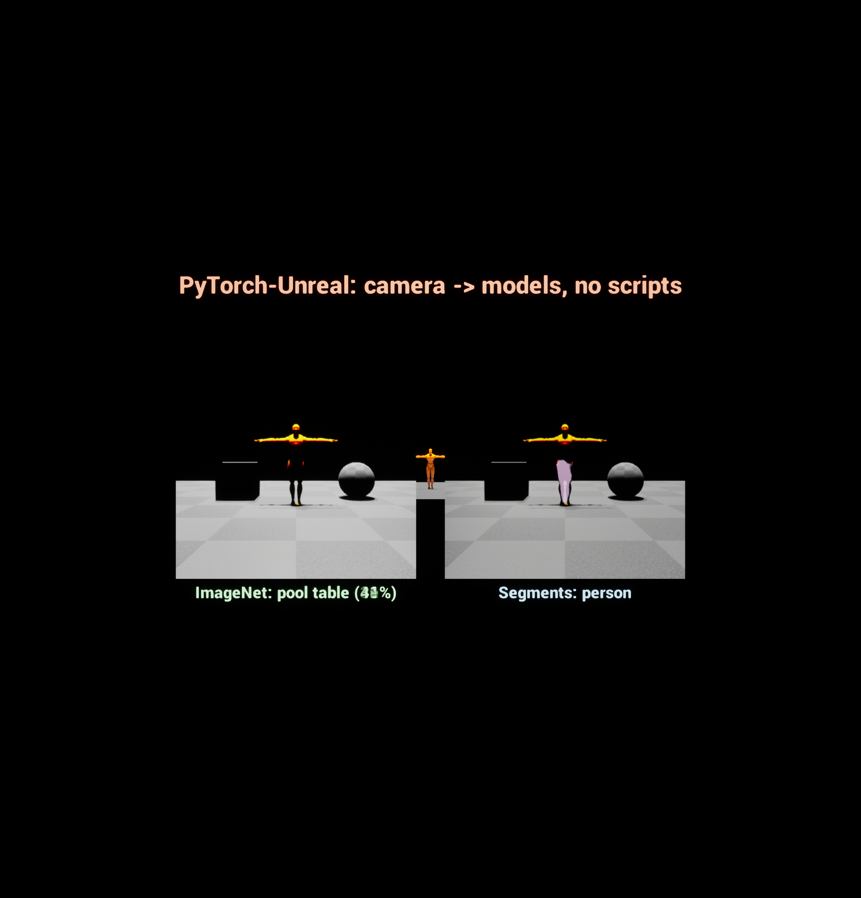
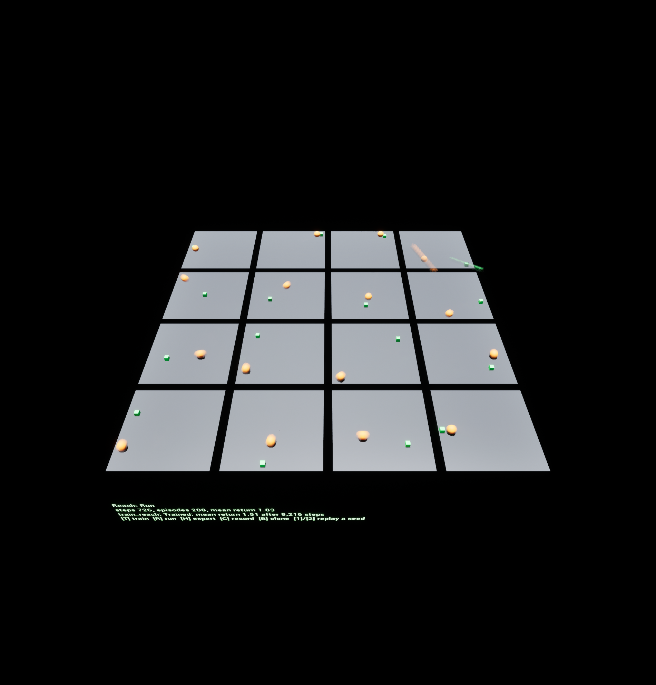
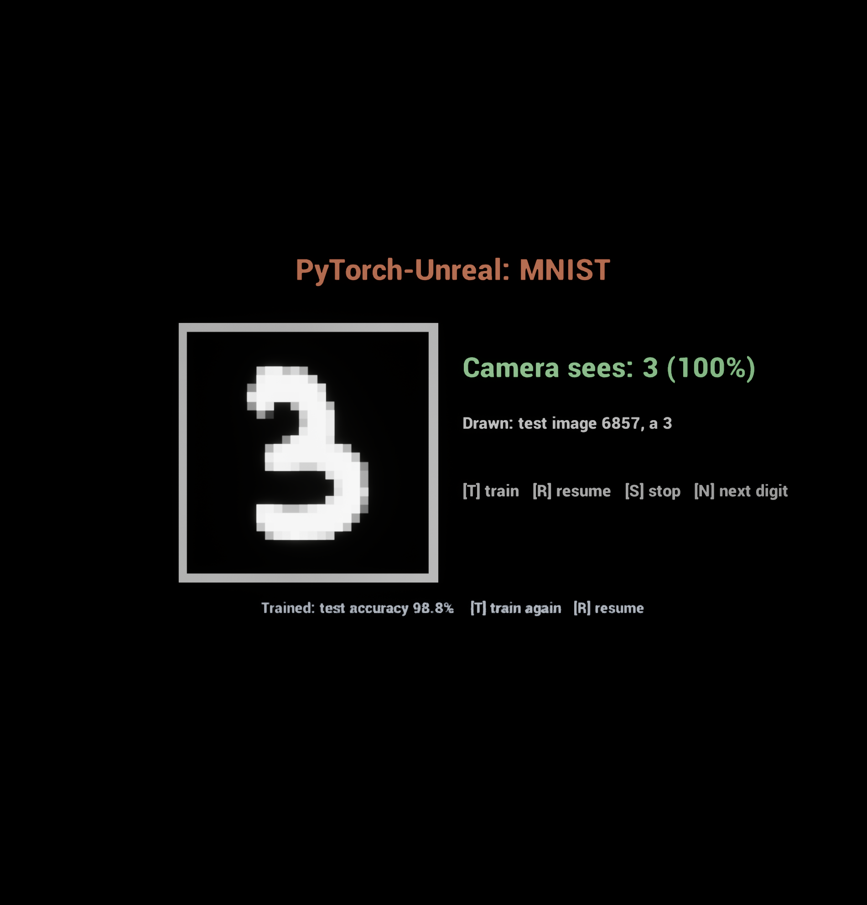

# PyTorch-Unreal
PyTorch ML support via [PythonCLI](https://github.com/getnamo/PythonCLI-Unreal) plugin for the Unreal Engine.

PyTorch runs **out of process** in an embedded Python (CPython 3.12) with a per-project venv. A crash in a native library never takes the editor down, and the GIL never touches the game thread.

- **Models:** each model is loaded once and shared by every caller.
- **Batching:** requests made in the same tick run as one batched forward pass on the GPU.
- **Hot reload:** a reloaded script keeps the model's weights.
- **Training and RL:** jobs train models while the game uses them; Unreal agents are a Gymnasium environment.
- **Shipping:** packaged games bundle CPU torch, or ship without Python and run the models' ONNX exports on NNE (DirectML or CPU) behind the same nodes.

| | |
|---|---|
| Python | `import unreal_torch as ut`: `@ut.model` classes with `@ut.export` methods, typed inputs (`ut.Image`, `ut.Tensor`, `ut.Audio`) |
| Unreal | a **Torch Model** asset (script + model name) and the **Run Model** node; `UTorchSubsystem` in C++ |
| Under it | [PythonCLI](https://github.com/getnamo/PythonCLI-Unreal) 0.5+ (services, deferred replies, jobs, shared-memory streams) on [CLISystem](https://github.com/getnamo/CLISystem-Unreal) 1.4+ |

## Setup

1. Put `PyTorch-Unreal`, [PythonCLI-Unreal](https://github.com/getnamo/PythonCLI-Unreal) and [CLISystem-Unreal](https://github.com/getnamo/CLISystem-Unreal) in your project's `Plugins/`. PyTorch also enables Unreal's NNERuntimeORT plugin.
2. Start the editor. PythonCLI installs the profile (Project Settings > Plugins > PyTorch) into `Intermediate/PythonCLI/venv` in the background.
   - The first time, the CUDA build of torch is about 3 GB.
   - Later installs come from uv's cache.

## Quick start

`Content/Scripts/digits.py` (or use the bundled `examples/digits.py`):

```python
import torch.nn as nn
import unreal_torch as ut

@ut.model("digits")                                    # the asset's Model Name
class Digits(ut.Model):
    def setup(self):                                   # once, on the model's device (CUDA if available)
        self.net = DigitNet()
        self.load_weights(missing_ok=True)             # Saved/Torch/Models/digits/digits.safetensors

    @ut.export(batch=True)                             # concurrent requests: one forward pass
    def classify(self, image: ut.Image(size=(28, 28), gray=True)) -> dict:
        p = self.net(image).softmax(-1)                # image: float (N, 1, 28, 28) on the device
        return {"digit": p.argmax(-1), "confidence": p.amax(-1)}
```

In Unreal:
1. Create a **Torch Model** asset (Miscellaneous > Data Asset > Torch Model). Set Script to `digits.py` and Model Name to `digits`.
   - **Refresh Signature** lists its methods and inputs.
2. In a Blueprint, call **Run Model** (Model, Method `classify`, Inputs `{"image": tensor}`) and read the result in **On Success**:
   - **Get Output Int** (`digit`);
   - **Get Output Float** (`confidence`).
3. Make the inputs with **Make Image Tensor From Texture / Render Target**, **Make Tensor From Floats** or **Make Tensor From Vector**. Non-tensor inputs go in **Json Inputs** (`{"top_k": 3}`).

## How requests run

- **One instance per process:** every Run Model call goes to the same model. Models stay loaded across PIE sessions; Unload Model frees them.
- **Stacking:** requests made in the same tick, for the same model and method with inputs of the same shape, are stacked on dim 0. They are sent as one call at the end of the frame, and the results are split back per request.
  - 64 Blueprint callers in one tick → one forward pass of 64.
  - The results arrive in the next frame: about 7 ms on an RTX 5090.
- **Micro-batching:** in Python, a `batch=True` method also merges calls that arrive within `max_wait_ms` (default 1 ms) of each other.
- **Unbatched methods** (`@ut.export` without `batch=True`) get one request at a time, without a batch dimension.
- **Typed inputs:**

  | Annotation | What the method gets |
  |---|---|
  | `torch.Tensor` | a tensor on the model's device, keeping its dtype |
  | `ut.Tensor(dtype=..., shape=(None, 64))` | checked per row (`None` is any size) and cast |
  | `ut.Image(size=(H, W), gray=False, normalize="unit"\|"symmetric"\|"imagenet", layout="NCHW")` | any image Unreal sends: (H, W, C) uint8 RGBA/BGRA or float, or (C, H, W). It's converted on the device: channel order, resize (antialiased), gray, normalization. |
  | `ut.Audio(rate=16000, mono=True)` | float audio resampled to `rate` |
  | `int`, `float`, `str`, `bool`, `dict`, `list` | JSON values (Json Inputs), shared by a stacked batch |

- **Outputs:**
  - A tensor is the output `output`.
  - A dict gives named outputs; tuples give `output0`, `output1`, ….
  - Tensors become `FPyTensor`s; numbers and strings go to the result's JSON.
  - With `batch=True`, outputs whose first dimension is the batch are split per request.
- **Runtime defaults:**
  - `torch.inference_mode()`, TF32 matmuls, and a CUDA stream per model.
  - Optional autocast (`precision="bf16"` / `"fp16"`).
  - Optional `torch.compile` (`compile=True` or `"reduce-overhead"`). triton-windows is installed with the CUDA profiles, and no MSVC or CUDA toolkit is needed. Batches are padded to power-of-two sizes so a compiled model compiles a few times rather than once per batch size.
- **Hot reload:** **Reload Script** (or editing and reloading) re-runs the script. Its models keep their weights wherever the shapes still match; `@ut.model(reload="fresh")` opts out.
- **Weights:** `load_weights()` / `save_weights()` use safetensors (`.pt` on request).
  - Lookup order: `Saved/Torch/Models/<model>/`, then `Content/Models/`, then `hf://org/repo/file` with huggingface_hub.
  - `publish(module_or_state)` swaps new weights into the live model.

## Training jobs

A `@ut.job` function in the model's script trains it (or does any long work) on its own thread. Unreal starts it, follows it and stops it, and the game keeps running its models meanwhile.

```python
@ut.job("train_digits")
def train(job: ut.Job, epochs: int = 2, lr: float = 2e-3):    # typed parameters, from Unreal's JSON
    live = ut.get_model("digits")                             # the instance the game is using
    net = copy.deepcopy(live.net).train()
    opt = torch.optim.AdamW(net.parameters(), lr)
    job.restore(net=net, opt=opt)                             # resumed run: back to its last checkpoint
    for epoch in job.range(epochs):                           # progress; ends early on Stop; resumable
        for x, y in job.track(loader):                        # progress within the epoch
            ...
        job.metrics(epoch=epoch, accuracy=acc)                # On Metrics; metrics.jsonl; TensorBoard if installed
        job.checkpoint(net=net, opt=opt)                      # <run>/checkpoint.pt
        job.publish("digits", net)                            # the game's next batch uses the new weights
    live.save_weights()                                       # Saved/Torch/Models/digits/digits.safetensors
    return {"accuracy": acc, "text": f"Trained: {acc:.1%}"}   # On Completed
```

- **Starting it:** the **Start Job** node (Model, Job, Params JSON, Resume, Own Process). Its pins are On Started, On Progress, On Metrics, On Completed and On Failed. The job object has State, Progress, Progress Message, Get Metric, Result Json, Run Dir and Stop.
- **Runs:** each start makes `Saved/Torch/Runs/<job>/<timestamp>/` with `config.json`, `metrics.jsonl`, `state.json`, `checkpoint.pt` and `result.json`.
  - **Resume** continues the latest run: `job.range` picks up after the last finished step, and `job.restore` loads the checkpoint.
- **Messages:** `job.progress(message="...")` sends a status line to Unreal, keeping the progress fraction.
- **Own Process** (or `@ut.job(process="dedicated")`): the job runs in a Python process of its own, so training never shares the GIL with inference. `job.publish()` then writes a weights file per publish (`Saved/Torch/Models/<model>/published-*.safetensors`); Unreal has the model's process load it, and it is deleted once loaded.
- **Data:** `ut.data_dir("name")` is `Saved/Torch/Data/<name>`, for datasets (torchvision downloads, recordings).

## Torch Component

**Torch Component** puts a Torch Model on an actor, with events instead of latent nodes:
- **Requests:** Run, Run With Tensor and Run With Render Target return a request id, and **On Result** (id, method, result) answers it.
- **Jobs:** Start Job and Stop Jobs; **On Job Progress / Metrics / Finished / Failed** report on them.
- **Loading:** **On Model Loaded** fires after the model loads on BeginPlay.
- **Sharing:** the model itself is still shared by every user.

## Streams into models: cameras, microphones, observations

To run a model on every frame of a camera, microphone or observation stream, add a **Torch Output Component** next to a Python stream component. It needs no script and no Blueprint graph.

| Setting | |
|---|---|
| Model, Method, Input Name | the exported method each frame goes to (Json Inputs: its other inputs) |
| Stream Component | which Python stream component on the actor (empty: the first) |
| Render Target Sinks | image outputs written into render targets after each frame, for image-to-image effects |

- **On Output** (Result) fires for every frame's result. Last Result, Result Count and Get Results Per Second are there too.
- **Camera (Latest) streams** keep one frame in flight. Frames that arrive meanwhile are skipped, so results never lag behind.
- **Queue streams** (audio, observations) run every frame.
- **Lockstep streams** get the method's result as the step's result.
- **On CUDA**, a stream's shared memory is page-locked once, so frames upload straight from Unreal's slots.
- **Image outputs:** return uint8 `(H, W, 4)` RGBA for video. It's a quarter of float RGBA and is written to RGBA8 render targets as is.
- **Launch-bound models:** many small models are, on Windows; `compile="reduce-overhead"` (CUDA graphs) makes them several times faster. MobileNetV3 goes from about 10 ms to 1.6 ms.

## Reinforcement learning

Unreal agents are a Gymnasium vector environment for any Python RL code: CleanRL-style loops, Stable-Baselines3 (`rl.sb3(env)`), PettingZoo (`rl.parallel(env)`). The environment steps in lockstep with the trainer.

| | |
|---|---|
| **Torch Environment** (actor) | the spec (named observation blocks, continuous or discrete actions), the mode, Steps Per Tick, Step Seconds, Max Episode Steps, Seed; the training job and the policy model |
| **Torch Agent Component** | one per agent: **On Collect Observations** (Set Observation / Vector / Observations), **On Apply Actions**, **On Reset Agent**, **On Heuristic**; Add Reward, End Episode (terminated or truncated), Random Range (the environment's seeded stream). C++ agents override the same functions. |

```python
from unreal_torch.rl import UnrealVectorEnv

@ut.job("train_reach", process="dedicated")
def train(job, total_steps: int = 500_000):
    env = UnrealVectorEnv("Reach", job=job)           # one sub-environment per agent; spaces from Unreal's spec
    obs, info = env.reset(seed=0)                     # reseeds Unreal's random stream and resets every agent
    while ...:
        obs, rewards, terminated, truncated, info = env.step(actions)   # SAME_STEP autoreset: info["final_obs"]
        job.publish("reach_policy", actor)            # the game's Run mode uses the new weights
```

- **Modes:**
  - **Train:** the training job starts on BeginPlay (in its own process by default). Each decision step sends every agent's observation, reward and done flags as one shared-memory frame and waits for the actions. When the job closes its env, the environment switches to Mode After Training (Run).
  - **Run:** the Policy Model's method (`act` by default) acts, stacked into one batched call per step. It's turn-based, so a run with the same seed replays exactly (Reset With Seed).
  - **Heuristic:** On Heuristic chooses the actions (player input, a scripted expert).
  - **Record:** Heuristic, writing every transition (obs, actions, rewards, terminated, truncated, next_obs, agent) as safetensors shards to `Saved/Torch/Recordings/<name>/<session>/`. Python reads them as `ut.data.Recording(name)`, a torch Dataset of (obs, actions) with `episodes()` and `transitions()`.
- **Time:** steps advance in fixed simulated time (Step Seconds), not frame time. Kinematic agents can take many steps per tick, so training runs faster than real time.
- **Gymnasium** is optional: without it (Project Settings > Plugins > PyTorch > Gymnasium) the env has minimal Box / Discrete spaces of its own.

## Shipping: NNE without Python

A Torch Model can carry an **NNE export** of its batched methods, and Run Model uses it where Python isn't there. The node, the named inputs and the outputs stay the same.

1. **Export To NNE** on the Torch Model asset:
   - It exports each `batch=True` method (or the asset's Export Methods) with `ut.export.onnx`: the dynamo exporter, opset 20, a dynamic batch dimension.
   - It imports the ONNX files as NNE model data assets next to the Torch Model (`<Asset>_<method>`), and fills the asset's NNE Methods.
   - It runs the export's reference rows through ORT CPU and DirectML, and checks them against torch's outputs (about 2e-7 on the examples).
2. **Backend** (on the asset): Auto uses Python where it's available (the editor; packaged builds that ship Python) and NNE otherwise. Python or NNE forces one.
3. **NNE Runtime:**
   - Auto times the GPU and CPU runtimes on the first run and keeps the faster one. GPU (DirectML) wins on image models, the CPU on small MLPs.
   - GPU or CPU forces one.
   - The runtimes per platform are in Project Settings > Plugins > PyTorch > Shipping: ORT DirectML, then ORT CPU.
4. **Packaging** (Project Settings > Plugins > Python CLI > Packaged Env Mode):
   - **None:** no Python in the build; the models run their NNE exports.
   - **Bundle** (the default) or Install On First Run: CPU torch ships too (PyTorch > Packaged Profile), and the models run in Python.
   - `Content/Models/` (weights) and the scripts are staged either way.

- **What exports:** what the method does with tensors, as torch ops. Python-side logic on values (`.item()`, `.tolist()`, strings) doesn't trace. Outputs that aren't per-row tensors (text, JSON values) are left out.
- **Images:** a `ut.Image` input exports as the converted image (e.g. float (N, 1, 28, 28)). Unreal converts textures and render targets the same way before NNE runs: channel order, antialiased resize, gray, normalization, layout.
- **Static batches:** DirectML is fast only with static shapes. With Export Static Batch N, a second model takes N rows; GPU runs of several rows are padded to it or run in chunks.
- **Speed:** the reach policy (64 agents) takes 0.28 ms on ORT CPU, against 5.3 ms for a round trip to Python. NNE runs happen on a worker thread, and the result arrives on the game thread.
- **In Python:** `ut.export.onnx("reach_policy", "act")` or `ut.export.onnx(net, inputs={"obs": (4,)})` writes the files to `Saved/Torch/Export/<model>/`.
- **Not on NNE yet:** Torch Output Components (streams go to Python), unbatched methods and jobs. In a build without Python, feed a camera to a model with Make Image Tensor From Render Target and Run Model.

## Example maps

### Vision: `/PyTorch/Examples/VisionExample`



- **Setup:** a scene capture's render target streams to two Torch Output Components; there are no scripts.
- **Classification:** an ImageNet classifier (MobileNetV3-Large) labels what the camera sees.
- **Segmentation:** an LR-ASPP segmenter tints each region by its class and writes the result into a second render target.
- **Speed:** both models are compiled with CUDA graphs. With the editor rendering at the same time, on an RTX 5090: classification about 47 results/s, segmentation about 33/s.
- **Script:** `examples/vision.py`. Its weights (35 MB) download once into `Saved/Torch/Hub`.
- **Content:** generated from `Tools/Examples/vision_example.json`.

`examples/audio.py` is the audio counterpart: pitch and loudness of a Python Audio Stream on the GPU, through `ut.Audio`. It's a template for torchaudio models.

### Reach (reinforcement learning): `/PyTorch/Examples/ReachExample`



- **The task:** 16 agents (orange) move on their arenas to their targets (green): 4 observations (the offset to the target, the velocity), 2 continuous actions (a velocity command). C++ classes in the PyTorchExamples module: `ATorchReachEnvironment`, `UTorchReachAgentComponent`.
- **On BeginPlay** PPO (`train_reach`, CleanRL's recipe, on the CPU in its own process) trains until the mean return reaches 1.5. That takes about 10 s; the policy is published as it learns, then the environment hands over to it (Run).
- **Keys:** **T** trains again, **R** runs the policy, **H** shows the scripted expert, **C** records it, **B** clones it (`train_reach_bc`, behavior cloning on the latest recording), **1** / **2** replay a seed.
- **Script:** `examples/reach.py` (the `reach_policy` model, both jobs). Content: `Tools/Examples/reach_example.json`.

### MNIST: `/PyTorch/Examples/MnistExample` shows the MNIST model reading test digits drawn into a canvas, while it trains:



- **BP_TorchMnistExample** (a Torch Component with `DA_Digits`) draws a test digit every 3 s from the model's `sample()`. It reads the canvas render target four times a second with `read()`.
- **On BeginPlay** it starts (or resumes) the `train_digits` job; the status line follows it.
- **Keys:**
  - **T** trains a fresh run from random weights: the readings start wrong and become right as the job publishes weights (about 99% after two epochs, a few seconds on a GPU).
  - **S** stops, **R** resumes, **N** draws the next digit.
- **Its script** is `examples/digits.py`. The content is generated by BlueprintOracle from `Tools/Examples/mnist_example.json`.

## Settings (Project Settings > Plugins > PyTorch)

| Setting | |
|---|---|
| Profile | **CUDA (Auto)**: the build matching the driver, plus triton-windows on Windows. Also CUDA 13.0, CUDA 13.2, CPU, ROCm (Linux), XPU, or None (bring your own). torch is pinned to 2.14.* |
| Extras | torchvision (on), torchaudio, ONNX export (on), Gymnasium + PettingZoo, TensorBoard, Hugging Face Hub |
| Packaged Profile | **CPU** (CPU torch replaces the editor's CUDA build in packaged builds that ship Python) or Same As Editor |
| Compile Cache Directory | `Intermediate/Torch/CompileCache`: Inductor and Triton caches, so compiled kernels survive restarts |

The Torch Model asset overrides the script's Device, Precision and Compile settings. It also sets Load (On First Use, On Startup, Manual) and Warmup.

## C++

```cpp
UTorchSubsystem* Torch = UTorchSubsystem::Get();
Torch->Run(DigitsModel, TEXT("classify"), { { TEXT("image"), ImageTensor } }, TEXT(""),
    [](const FTorchResult& R) { if (R.bSuccess) { const int32 Digit = UTorchBlueprintLibrary::GetOutputInt(R, TEXT("digit")); } });
```

**Options** (`FTorchRunOptions`):
- `bBatched`: inputs already have a batch dimension.
- `Layouts`: e.g. `{"image": "BGRA"}` for raw render-target pixels.
- `bImmediate`: send now, outside the tick's stack.

`LoadModel`, `UnloadModel`, `ReloadScript`, `FetchSignature` and `GetStats` cover the rest.

## Tests

- **Engine-free** (unreal_torch over PythonCLI's protocol, 34 checks; add `--examples` to also train the digits example, 39):
  `<PythonCLI>/ThirdParty/python/Win64/python.exe -I Content/Scripts/tests/torch_harness.py --site <venv>/Lib/site-packages`
  - A second `--site` adds a folder, e.g. one with gymnasium, to test the env with it.
- **In Unreal** (`PyTorch.Model.*`, `PyTorch.Jobs.*`, `PyTorch.Streams.*`, `PyTorch.RL.*`, `PyTorch.NNE.*`, `PyTorch.Packaged.*`, `PyTorch.Settings.*`, `PyTorch.Examples.*`):
  `UnrealEditor-Cmd.exe <Project>.uproject -ExecCmds="Automation RunTests PyTorch; Quit" -unattended -nullrhi -nopause`
  - The map tests and `PyTorch.Streams.RenderTargetToModel` need a real RHI: `-RenderOffscreen` instead of `-nullrhi`.
  - The job tests download MNIST once.
  - `PyTorch.Packaged.*` also run in packaged builds: the examples' NNE exports (and Python, when the build has it). `PyTorch.Tools.ExportExamples` (on demand) refreshes the examples' NNE exports.
- **Benchmarks** (`PyTorch.Benchmarks.*`, the T0 measurements): see [Tools/Benchmarks](Tools/Benchmarks/README.md).
